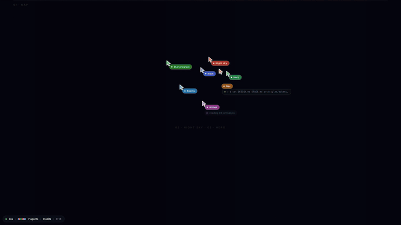

# Liveswarm

[](liveswarm/media/nocturne-wide.mp4)

<sub>A real session: the main Claude Code agent and 12 subagents building one page. Click for the full 69-second video.</sub>

**Watch Claude Code build your app as a swarm of live cursors.**
Every cursor is a real agent. Every move is a real edit.

Free and open source. No model calls. Nothing leaves your machine.

## Install

```sh
claude plugin install liveswarm --marketplace liveswarm/liveswarm
```

On an older Claude Code without `--marketplace`, use two steps: `claude plugin marketplace add liveswarm/liveswarm`, then `claude plugin install liveswarm@liveswarm`.

Or inside Claude Code: `/plugin marketplace add liveswarm/liveswarm`, then `/plugin install liveswarm@liveswarm`.

Then run these inside Claude Code:

| Command | What you get |
|---|---|
| `/liveswarm:demo` | See it in under a minute. A replay of a real build (main agent plus 12 subagents) plays on your own screen. |
| `/liveswarm:watch` | Your own app, zero setup. Finds your dev server and shows agent cursors on it. |
| `/liveswarm:record` | Share it. Run it after `watch`, then ask Claude to build. Films the build in vertical and widescreen, with a smart timelapse and end card, and stops by itself when the agents go quiet (or `/liveswarm:record --stop`). |
| `/liveswarm:setup` | Exact landings. Adds a dev-only Vite tagger (one file in `.liveswarm/`) so cursors land on the precise element. |
| `/liveswarm:doctor` | Checks that everything is working. |

The demo is labelled "Replay of a real Claude Code session". It is a recording, not a simulation.

## What it costs you

No model calls and no tokens spent. Liveswarm only listens to events Claude Code already emits, and its hooks run in the background and print nothing. The five slash commands are user-only (`disable-model-invocation`), so Claude does not pick them up on its own. Measured: about 12 ms per event, 58 to 66 MB of memory, and no extra input tokens: on Claude Code 2.1.314 a fresh session's starting context was 32,160 tokens with Liveswarm installed and 32,695 without it. Full numbers in [liveswarm/docs/overhead.md](liveswarm/docs/overhead.md).

## Privacy

Everything stays on 127.0.0.1. Hook events travel over a local unix socket. The live feed only answers pages on your own machine (localhost, 127.0.0.1, `*.localhost`): any other website you have open gets refused. If your app runs on a LAN address or a custom dev domain, allow it with `LIVESWARM_ORIGINS=http://192.168.1.5:5173`. File contents are never forwarded and shell commands are redacted before display or logging. No accounts, no telemetry, no network calls.

## How it works

```
Claude Code hooks -> conductor (local) -> overlay on your app preview
```

1. The plugin registers async hooks. Each tool call by the main agent or a subagent is sent to a small local server (the conductor).
2. `watch` starts a local proxy in front of your dev server and injects the overlay into the page. It passes websockets and hot reload straight through.
3. The overlay draws one named cursor per agent. A cursor moves only when a real hook event says so. With `setup`, cursors land on the exact JSX element that changed; without it they use a DOM-change fallback.

Event format and endpoints: [liveswarm/CONTRACT.md](liveswarm/CONTRACT.md).

## Support

| Platform | Status |
|---|---|
| macOS | Built and tested here. |
| Linux | Expected to work (Node 20+, curl, bash). Not yet tested. |
| Windows | Not supported yet. Hooks need bash and curl; use WSL at your own risk. |

Needs Node 20+ (22 recommended) and `curl`. `record` also needs Google Chrome and ffmpeg (`brew install ffmpeg`); its first run downloads `playwright-core` and Playwright's small ffmpeg build (about 10 MB, once) into `~/.liveswarm/deps`. Works with any web framework through `watch`; exact landings need Vite.

Liveswarm uses port 7777 on 127.0.0.1. If another program uses it, `/liveswarm:doctor` names it and shows how to pick another port.

## Uninstall

`claude plugin uninstall liveswarm@liveswarm`. The small background helper exits on its own once the plugin is gone (within a minute). `~/.liveswarm` keeps a week of local event logs; delete it if you like.

## Credits

Inspired by Joel Califa's Swarm and Dhvanil Patel's Swarm Rebuild, which made the swarm-cursor look famous.
Their cursors are a beautiful animation; Liveswarm's are real agents doing real work.

Liveswarm is an independent project and is not affiliated with or endorsed by Anthropic. Claude and Claude Code are trademarks of Anthropic.

## License

[MIT](LICENSE)
